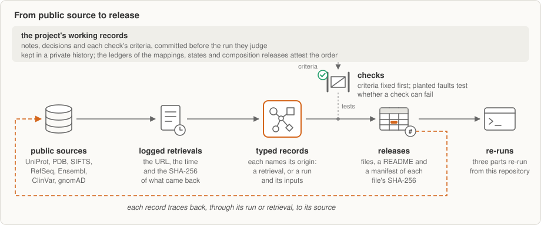
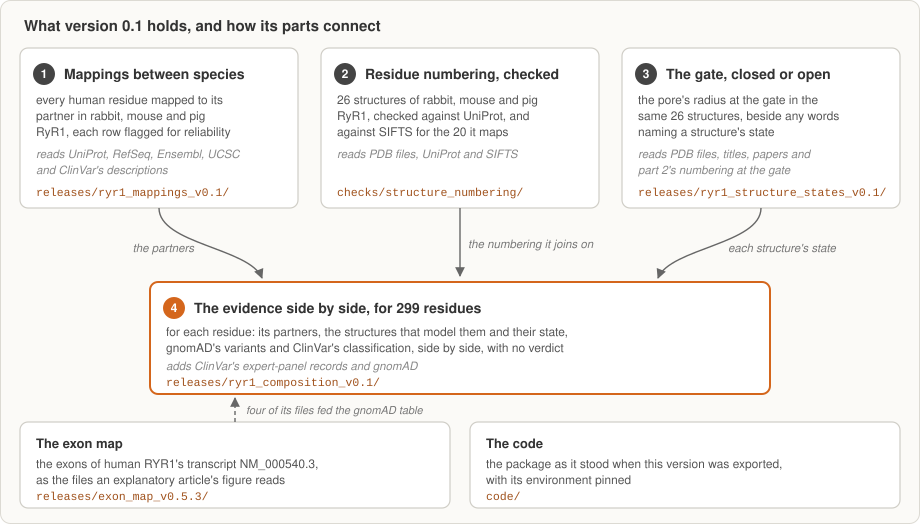
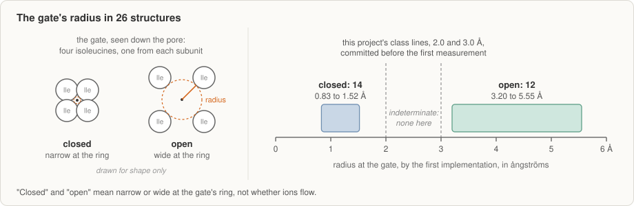

<h1 align="center">ChannelScope</h1>

<p align="center">
<b>Evidence about the residues of RyR1, the calcium-release channel of skeletal muscle,<br>
gathered from public sources, with each value's source recorded.</b>
</p>

<p align="center">
<sub>ChannelScope began at <a href="https://cerebralvalley.ai/e/built-with-claude-life-sciences">Built with Claude: Life Sciences</a>,
a virtual hackathon hosted by Anthropic and Cerebral Valley in July 2026, where its proposal was accepted to the Build
track, and was rebuilt from first principles from 28 September 2026 with Claude, Anthropic's AI model, under the
author's direction. An explanatory article, <a href="https://rajiv-sangle.github.io/channelscope/">ChannelScope</a>, gives the background: how RyR1 works, how its gene maps to the protein, the kinds of change and how some are linked to disease. Reviews, corrections and other perspectives are welcome: please open an issue on this repository.</sub>
</p>

<p align="center">
<sub>Version 0.1 is a pre-release and a proof of concept. It reports what each check found, failures included,
and it makes no judgement about any variant. <br>
The table under <a href="#what-is-in-version-01">What is in version 0.1</a>
lists what is in it and what is not yet.</sub>
</p>

<p align="center">
<a href="#why-ryr1-and-why-provenance">Why RyR1</a> ·
<a href="#where-channelscope-is-going-the-aim-and-its-premises">Where it is going</a> ·
<a href="#how-channelscope-works">How it works</a> ·
<a href="#what-can-go-wrong-and-how-version-01-handles-it">What can go wrong</a> ·
<a href="#what-is-in-version-01">What is in version 0.1</a> ·
<a href="#checking-it-yourself">Check it yourself</a> · <br>
<a href="#what-version-01-can-tell-you-about-a-variant">A new variant</a> ·
<a href="#the-results">Results</a> ·
<a href="#what-failed">What failed</a> ·
<a href="#re-running-the-results">Re-running</a> ·
<a href="#what-version-01-shows-of-the-aim-and-next-steps">What 0.1 shows</a> ·
<a href="#what-channelscope-does-not-claim">What it does not claim</a>
</p>

ChannelScope starts from one question: what does a missense variant, one that changes a single amino acid, do to RyR1's structure and function? Version 0.1
does not answer it, and it classifies no variant. It gathers, from public sources, the evidence an answer would rest
on, and keeps where each value came from.

Experimental structures of the whole channel are all of animal RyR1.[^census] Reading a human residue on an animal
structure takes three steps, and each can go wrong without any error message:

1. find the residue's partner in the animal's RyR1, whose numbers differ from the human ones by an amount that changes
   along the chain;
2. find that partner in each structure, whose authors may number its residues their own way;
3. know which state each structure captured: whether the pore is narrow or wide at its gate.

A slip at any step puts evidence on the wrong residue, or in the wrong state. Version 0.1 takes the three steps with
checks, and records each value's source. For every residue of human RyR1, it gives the partner residue, if there is
one, in rabbit, mouse and pig RyR1. For 299 residues, it also gives which of 26 chosen experimental structures model the partner, each structure's
measured gate state, the missense variants that [gnomAD](https://gnomad.broadinstitute.org/), a public database of
variants seen in large population studies, records there, and the records of
[ClinVar](https://www.ncbi.nlm.nih.gov/clinvar/), the public archive of variants and their reported clinical
significance. The 299 are the residues at which at least one of ClinVar's expert-panel records (the ones ClinVar marks
as reviewed by an expert panel) describes a single missense change; at 47 of them, more than one record does. It comes as data releases, each
saying where its values came from, and the Python package, its environment pinned, that checks their records. Three
parts can be re-run from this repository: one check of the mappings, the gate's radii and the composition.

Version 0.1 is a proof of concept. The aim is evidence that keeps its provenance, takes new sources without
rewriting, can be composed around a residue and carried over to other proteins, and is of use downstream, in
choosing variants to test and as data for models. For one protein, version 0.1 takes the three steps above with
checks, for 299 residues and 26 structures, each value's source recorded and each withheld record listed with its
reason. [Where ChannelScope is going](#where-channelscope-is-going-the-aim-and-its-premises) gives what is still a premise in each part of the aim, with what
would count against it, and [What version 0.1 shows of the aim](#what-version-01-shows-of-the-aim-and-next-steps) what this version shows of each.

Reading a new variant's effect from this evidence would first need tests on known variants, benign ones among them,
which version 0.1 has not run.

Provenance is central to this project, and its own text was held to the same standard: facts were checked against
their sources, numbers against the data they were taken from, and claims from published work are attributed and
kept to their authors' scope. Where a check's criterion was fixed only after trial runs, or its outcome could be
foreseen, the text says so. Mistakes may still have got through, the AI model's or the author's; please report any
you find.

A code in brackets, such as (A6), is the name a release gives one of its checks or rules, so that it can be found
there. Each release numbers its own; [How ChannelScope works](#how-channelscope-works) says where they are defined.

<details>
<summary><b>How to read the identifiers on this page and in its files</b></summary>

- **P21817** is [UniProt](https://www.uniprot.org/)'s accession for human RyR1, and P11716, E9PZQ0 and P16960 are those for rabbit, mouse and pig
  RyR1. **P21817-1** is isoform 1, the sequence the entry displays: an isoform's identifier is "the primary accession
  number of the entry, followed by a dash and a number". In the releases' file names, **`.sv3`** is this project's mark
  for the sequence's version (UniProt's "sequence version 3"), so that each mapping names the exact sequence it was
  made on.[^uniprotids]
- **NM_000540.3** is one of RYR1's two transcripts in NCBI's RefSeq; the number after the dot is its version, which
  rises by one whenever the sequence changes. It is the gene's MANE Select transcript: MANE (Matched Annotation from
  NCBI and EMBL-EBI) keeps a Select set of "one transcript at each locus", which it calls "useful as a universal
  standard for clinical reporting".[^refseqmane]
- **GRCh38** is the Genome Reference Consortium's Human Build 38, the human reference genome assembly. The exon map
  reads its patch release GRCh38.p14, whose patches changed no chromosome coordinates.[^grc]
- **9PWO**, **6X36** and the like are PDB IDs: each names one entry of the Protein Data Bank, and an entry keeps its ID
  when it is revised.[^pdbversions]
- **R614C** names a change with one-letter amino-acid codes: the arginine (R) at residue 614 changed to a cysteine (C).
  HGVS Nomenclature, the recommendations for describing sequence variants, writes it on the coding DNA as c.1840C>T:
  the base at position 1840, counted from the A of the start codon, changed from C to T. On the protein, a predicted
  consequence, one without experimental evidence (no RNA or protein sequence analysed), is written p.(Arg614Cys):
  three-letter codes are preferred, and the parentheses mark the prediction.[^hgvs] The composition's ClinVar table
  gives both in the record's own title, "NM_000540.3(RYR1):c.1840C>T (p.Arg614Cys)", where the title's parentheses
  hold the protein change, written without HGVS's parentheses for a prediction.
- **VCV000012964.91** is a ClinVar accession: the record that gathers every submission about one variant, here R614C,
  at its version 91.[^clinvarvcv]
- **MONDO:0007783** is an identifier in the Mondo Disease Ontology, here the one ClinVar gives for "Malignant
  hyperthermia, susceptibility to, 1".
- **A SHA-256** is a checksum: a fingerprint of a file's bytes that changes if a single byte does.

</details>

<p align="center">

</p>

## Why RyR1, and why provenance

RyR1 is the calcium-release channel of skeletal muscle. It sits in the membrane of the sarcoplasmic reticulum, the
muscle cell's internal store of calcium. When the cell is excited, the channel opens and releases calcium, and that
release plays a key role in triggering contraction. Four identical subunits form the channel; in humans each has 5,038 residues.[^uniprot]

The RYR1 gene encodes the subunit, and a missense variant in the gene changes one residue of the protein. Some of
these changes cause disease: UniProt, a public database of protein sequences and what is known about them, links
variants of RYR1 to susceptibility to malignant hyperthermia, to several congenital
myopathies and to King–Denborough syndrome.[^uniprot] Others are classified as of uncertain significance: the research may
not yet be enough to confirm or rule out a link to disease, or it may conflict.[^vus] Studies of many variants linked to
malignant hyperthermia "generally agree on the overall gain-of-function phenotype", a 2022 review writes: the changed
channel is more sensitive to the agents that trigger it, such as calcium, caffeine and volatile
anaesthetics.[^woll2022] That is one reason to record each structure's state: a residue's surroundings could then be
compared between closed and open structures, which version 0.1 does not do (the
structure premise in [Where ChannelScope is going](#where-channelscope-is-going-the-aim-and-its-premises)).

The [explanatory article](https://rajiv-sangle.github.io/channelscope/) tells this background at length: [how RyR1 works](https://rajiv-sangle.github.io/channelscope/#what-ryr1-is),
[from gene to residue](https://rajiv-sangle.github.io/channelscope/#gene-to-residue), [the kinds of change](https://rajiv-sangle.github.io/channelscope/#kinds-of-change) and
[how some are linked to disease](https://rajiv-sangle.github.io/channelscope/#linked-to-disease).

What a variant does to the channel depends on where its residue sits, in which state of the channel, and what else is
known about that position. That evidence is spread across sequence databases, structure archives, variant databases
and papers, and each source numbers residues in its own way. To attach a value measured on a structure to the right
residue of the protein, which this page calls joining, the structure's residue numbers must first be matched to
UniProt's, and one residue's slip in that matching moves every value joined across it. Version 0.1's numbering check
records an offset of one in five pig structures: their author residues 2736 to 2939, the numbers their authors gave them,
correspond to residues 2737 to 2940 of pig RyR1 in UniProt ([P16960](https://www.uniprot.org/uniprotkb/P16960/entry)), so a value joined there by author number alone
would land one residue off ([result 2](#2-the-residue-numbering-of-26-structures)).

ChannelScope brings the evidence together around a residue. It says where each value came from, and where sources
disagree, it keeps their values side by side instead of merging them into one verdict.

## Where ChannelScope is going: the aim, and its premises

The project's aim, an aspiration rather than a promise, is
evidence that keeps its provenance, takes new sources without rewriting, can be composed around a residue and
carried over to other proteins, and is of use downstream, in choosing variants to test and as data for models. The
lower half of the figure is what version 0.1 shows. Each statement in the upper half is a premise: it is not shown
here, and the table names what would count against it. Its terms, such as records, the validator and re-runs, are explained
under [How ChannelScope works](#how-channelscope-works).

<p align="center">

</p>

| Theme | What is a premise | What would count against it |
|---|---|---|
| Adding evidence | A new source or method is added without rewriting what exists | A validator finding beyond the withheld items, a clean re-run that does not reproduce every checksum, or an earlier record that has to change |
| Composing evidence around a residue | What version 0.1 does for 299 residues holds for every residue and for further sources | Version 0.1's checks failing when run at full scale |
| Structure, by state | In 2013, Kimlicka et al. reported that, in the N-terminal region of RyR1 and RyR2, the largest cluster of disease mutations (20, counting RyR1's and RyR2's together) faces the boundary between neighbouring subunits. They propose that the contacts across that boundary are disrupted when the channel opens, and that a random disease mutation there is much more likely to weaken them than to strengthen them.[^kimlicka2013] | Those contacts, computed in closed and open structures by a method fixed in advance, found the same within a margin also fixed in advance; or measurements of what disease mutations there do to them showing that they weaken the contacts no more often than they strengthen them |
| Transfer to another protein | Evidence gathered for RyR1 transfers to its paralogue RyR2 | RyR1-derived evidence that separates RyR2's disease positions no better than a baseline fixed in advance |
| Downstream value | Laying the evidence side by side helps choose variants of uncertain significance for laboratory tests | Expert disagreement with candidate mechanisms drafted from the evidence, or functional data that contradict them |
| Value for models | The tables can serve as training data for models | Performance that does not survive an audit for leakage between training and test data |
| Other genes | The record types used for RyR1 serve other genes | Any RyR1-specific change the record types need |

Views on any of these premises are welcome. What version 0.1 shows of each part comes after the results, in [What version 0.1 shows of the aim](#what-version-01-shows-of-the-aim-and-next-steps).

## How ChannelScope works

ChannelScope is built to place each residue on experimental structures of the channel, by state, wherever they
resolve it, and to say where they do not; to get there through checked mappings between species; and to set the
other evidence beside it without a verdict. The table under [What is in version 0.1](#what-is-in-version-01) and the sections after it say which parts run today. That the method carries
over to other genes is a premise until a second gene is run.

<p align="center">

</p>

Three releases, the mappings, the states and the composition, keep their evidence as records, as the steps below
describe. The exon map's release keeps none. Its exon rows were copied from records of this project's evidence graph
that this repository does not publish, and the scripts that built its files, which its manifest names by their SHA-256,
kept no records of the kind the other releases keep. Its header lists its 14
sources, each with its release where the source states one and each download with its URL, time and SHA-256, and its
manifest gives each file's SHA-256 and the checks its build ran.

1. **Public sources.** The values come from public sources, among them [UniProt](https://www.uniprot.org/) for
   protein sequences, the [Protein Data Bank](https://www.rcsb.org/) (PDB) for structures,
   [SIFTS](https://www.ebi.ac.uk/pdbe/docs/sifts/) for the map between the two, NCBI's
   [RefSeq](https://www.ncbi.nlm.nih.gov/refseq/) and [Ensembl](https://www.ensembl.org/) for the gene, and
   [ClinVar](https://www.ncbi.nlm.nih.gov/clinvar/) and [gnomAD](https://gnomad.broadinstitute.org/) for variants. Three of the mappings' checks compare with figures held outside this repository,
   as [result 1](#1-mappings-from-human-ryr1-to-rabbit-mouse-and-pig-ryr1) says.
2. **Logged retrievals.** The retrieval behind each value is logged with the full URL, when it was made, the source's
   release where the source states one, and the SHA-256 checksum of what came back. When a re-run fetches a structure
   file again, it checks the file against that checksum and refuses a file that differs.
3. **Typed records.** In those three releases, each value is kept in a record of a fixed type, such as a source, retrieval, method, run, table
   or check result; the type fixes the fields the record must have. Each record says where it came from in the terms of [PROV-O](https://www.w3.org/TR/prov-o/), a standard
   vocabulary for provenance from the [World Wide Web Consortium](https://www.w3.org/) (W3C), the body that develops
   the web's standards: the source and retrieval a value came from, or the method, code version and run that derived
   it, with its inputs by checksum. A record's identifier is computed from what the record says, so two records that
   say the same thing have the same identifier. Two fields are left out of that computation, the retrieval or run that
   wrote the record and the agent, person or program, credited with it, so that the same method, run again on the same inputs, writes records with
   the same identifiers, and a re-run can be matched to the original record by record. A validator checks every
   record against the schema, the definition of each record type in the package's
   [`models.py`](code/src/channelscope/models.py) (see below).
4. **Checks.** A check's criteria, including what would count as a failure, are committed, that is, saved in the
   project's version history, before the run they judge,
   and checks are tested with planted faults: errors put in on purpose, to test whether a check can catch them.
   Some planted faults could not fail and some were missed. Each release reports its checks as they came out,
   failures included (see [What failed](#what-failed)), and where an outcome could be seen or foreseen before its
   criteria were fixed, the release says so. Each release names its checks, and the
   numbering check its rules, by short codes of its own, so one code can mean different checks in two releases. This
   page describes each check by what it does and gives its code in brackets, so that it can be found in its release:
   for example, the mappings release's check against ten residue pairs stated in published papers (A6). The mappings,
   states and composition releases report how their checks came out in their READMEs and define each check, with
   what would count as a failure, in their `criteria/` folders; the exon map's release does both in its
   `manifest.json`.
5. **Releases.** Results are published as releases: data files, a README that says what they hold and how they were
   checked, and a manifest that lists each file's SHA-256. The numbering check's tables sit apart, in
   [`checks/structure_numbering/`](checks/structure_numbering/), with its outcomes in their headers. The commits that
   fixed each check's criteria are in this project's private working history. The mappings, states and composition
   releases each carry a ledger, a dated list of each criterion, build, trial and recorded run, which attests that
   order without showing the commits.
6. **Re-runs.** Three parts can be re-derived from this repository with open-source tools and public sources (see
   [Re-running the results](#re-running-the-results)).

In the mappings, states and composition releases, `graph/records/` holds the typed records, one JSON line each (such
as `retrieval.jsonl`); `graph/raw/` the raw answers the release stores; `graph/tables/` its tables; `criteria/` the
criteria of its checks, as committed; and `withheld.tsv` what the release refers to but does not carry, each with its
reason.

**One value, followed back.** The drawing below follows one value of the composition back to its public sources: the
row for human residue 614 in chain A of the pig structure 9PWO, the row that [Checking it
yourself](#checking-it-yourself) traces by commands. Each box is a record, and each arrow is a link the record itself
holds, named in plain words with its PROV-O term in brackets:

- a data table names the run that made it, "made by" (wasGeneratedBy), and the inputs that run read, "from" (used);
- a run is one execution of the code, with its command, times and environment, and it follows a method, "following"
  (PROV-O's Plan): a written procedure, with the digest and version of the code that carries it out;
- a logged download names the URL asked, when, and the SHA-256 of what came back, from a public source;
- a run or a download names the program that carried it out, "run by" (wasAssociatedWith), and a data record names
  the agent credited with it, "credited to" (wasAttributedTo).

<p align="center">

</p>

Read from the top, the drawing answers "where did this value come from?" The run that composed the evidence wrote the
row, and the row names the tables it was built from. The drawing follows three of them, the mapping from human to pig,
the numbering tables and the gate's re-measurement, each made by its own run from logged downloads of UniProt, SIFTS
and the PDB. The orange path follows the gate's re-measurement back to the PDB's file for 9PWO. Two methods on the
path, the numbering check's and the gate re-measurement's, are withheld because they cite this project's private
working records; each is listed in the release's `withheld.tsv` and summarised in its `withheld_records.json`.

Each link can be checked: a download's SHA-256 against the file fetched again, a method's code digest against the code
where the release carries it, and a record's identifier against its content, with the validator. The trace stops at
the public source: ChannelScope records what came back and when, and does not vouch for the source itself. The records
drawn are in [`releases/ryr1_composition_v0.1/graph/records/`](releases/ryr1_composition_v0.1/graph/records/).

<details>
<summary><b>What the validator reports on each release, and why</b></summary>

The validator, `uv run --project code channelscope --graph releases/<release>/graph validate`, checks each record
against its type, and reports as findings the records and stored answers a release refers to but does not carry;
files that a re-run fetches again, such as structure files, give no finding. The mappings release gives
1: UCSC's copy of the gene's region, which it does not carry because UCSC's terms do not clearly allow passing it on.
The states release gives 43: pointers to two withheld method records, whose content cites this project's working
sessions. The composition release gives 13: 8 pointers to three withheld method records of the same kind, and 5 raw
answers it does not carry. Each item is listed, with its reason, in the release's `withheld.tsv`, and the release's
README explains it. The exon map's release keeps no records, so there is nothing to validate.

</details>

## What can go wrong, and how version 0.1 handles it

Each of the three steps at the top of this page can go wrong without a sign, and version 0.1's own data hold an example
of each. Most were known or predicted before the runs, as the releases say. What version 0.1 adds is that its checks
handle each one in the open, and its records let anyone see where each of these values came from; what can be re-run
from this repository is listed under [Re-running the results](#re-running-the-results):

- **The mapping (step 1 of 3): a published pair that the human sequence cannot hold.** A paper's methods equate a rabbit
  mutant with the human mutant of the same number, R164C, but human residue 164 is a valine; the same paper's
  introduction gives the pair the mapping reproduces, human R163 with rabbit R164. The check that compares the mapping
  with published pairs fails on it, as the project predicted before the run, and the failure is reported
  ([What failed](#what-failed)).
- **The numbering (step 2 of 3): an offset in five pig structures.** Their author residues 2736 to 2939 correspond to
  residues 2737 to 2940 of pig RyR1 in UniProt, so a value joined there by author number alone would land one residue
  off. This project's alignment alone shows it, since SIFTS maps none of these structures, and that outcome was known
  before the run; the numbering tables record it in every RyR1 chain
  ([result 2](#2-the-residue-numbering-of-26-structures)).
- **The state (step 3 of 3): words that are missing, and a condition that does not settle the state.** The titles of
  [8VJJ](https://www.rcsb.org/structure/8VJJ), [8VJK](https://www.rcsb.org/structure/8VJK) and 6W1N name no state.
  8VJK's title names only its sample, "high-Ca2+/CFF/ATP dataset": calcium, caffeine and ATP, agents that activate
  the channel, yet measured, its gate is closed, with a radius of 0.85 Å. Its authors, who by their Results added the
  calcium at 0.25 mM, write that "the RyR1 pore adopted only closed conformational states due to the high [Ca2+]
  inactivating RyR1 as reported previously"; the release did not record their paper's words.[^weninger2024] A
  condition names the agents, not the state they leave the channel in, so a state read from a title or a condition
  can be missing or wrong; the release measures each gate and keeps beside the measured class the words, where any
  are recorded, that name the structure's state
  ([result 3](#3-the-pore-at-the-gate-of-the-same-26-structures)).
- **A changed residue that is not declared.** Three pig structures of Woll et al. ([6X34](https://www.rcsb.org/structure/6X34),
  6X35 and 6X36) carry a cysteine at pig residue 615 (human 614), where pig RyR1 in UniProt has an arginine, and their files do not
  declare the change: their entries name no UniProt reference to declare it against (the states release's survey). Without a declaration, a residue
  that differs from the reference could be a real change, a numbering slip or a modelling error, and the numbering
  check reports it and does not join it there, by a rule fixed before the run.
  [9PWO](https://www.rcsb.org/structure/9PWO), which declares its R615C, is joined, and its rows mark the cysteine as a
  declared variant ([result 4](#4-the-evidence-for-a-residue-set-fixed-in-advance)).

The records also keep the project's own history:

- **Corrections that keep what they correct.** Nineteen check records of the states release were re-issued on
  14 October 2026: three had stated their control or outcome wrongly, five gained the row of the criteria they are
  judged by, and the other eleven changed in no fact. Each new record names the one it revises, and the old ones stay
  in the release ([result 3](#3-the-pore-at-the-gate-of-the-same-26-structures)).
- **Files the PDB has since replaced.** On 14 October 2026 the PDB released a new revision of two measured structures,
  9ZO8 and 9ZOE. Each retrieval record keeps the SHA-256 of the file measured, so a re-run tells the new revision from
  the measured one, and the releases carry patches that rebuild the measured files byte for byte, with the versions of zlib, the
  compression library, tested
  ([Re-running the results](#re-running-the-results)).

## What is in version 0.1

<p align="center">

</p>

| Part | In this version? |
|---|---|
| Residue mappings from human RyR1 to rabbit, mouse and pig RyR1, with their checks and evidence records | Yes: [`releases/ryr1_mappings_v0.1/`](releases/ryr1_mappings_v0.1/) ([result 1](#1-mappings-from-human-ryr1-to-rabbit-mouse-and-pig-ryr1)) |
| The residue numbering of 26 RyR1 structures, checked against SIFTS (the European Bioinformatics Institute's map from Protein Data Bank entries to UniProt) where it maps them (20 of 26) and by this project's alignment | Yes: [`checks/structure_numbering/`](checks/structure_numbering/) ([result 2](#2-the-residue-numbering-of-26-structures)) |
| The pore's state in the same 26 structures, measured at the gate | Yes: [`releases/ryr1_structure_states_v0.1/`](releases/ryr1_structure_states_v0.1/) ([result 3](#3-the-pore-at-the-gate-of-the-same-26-structures)) |
| The evidence for a residue set fixed in advance, laid side by side | Yes: [`releases/ryr1_composition_v0.1/`](releases/ryr1_composition_v0.1/) ([result 4](#4-the-evidence-for-a-residue-set-fixed-in-advance)) |
| The exons of human RYR1's transcript [NM_000540.3](https://www.ncbi.nlm.nih.gov/nuccore/NM_000540.3) on [GRCh38](https://www.ncbi.nlm.nih.gov/grc/human), with its codons, residues and sequences, as the files that the exon-map figure of [the explanatory article](https://rajiv-sangle.github.io/channelscope/) reads | Yes: [`releases/exon_map_v0.5.3/`](releases/exon_map_v0.5.3/). It cannot be rebuilt from this repository, and it withholds a test set; its README says why |
| The code | Yes: [`code/`](code/), the package as it stood when this version was exported, with the lines changed for publication listed in [`releases/ryr1_mappings_v0.1/code_changes.tsv`](releases/ryr1_mappings_v0.1/code_changes.tsv). It is newer than the code some earlier runs used, which each run's record identifies by its digest, so it is not the code of any one run. The states and composition releases carry the scripts that built their tables. The numbering check's code is not yet here |
| Re-running the results from this repository | In part: the states, the composition and the mappings' comparison with published residue pairs (A6) ([Re-running the results](#re-running-the-results)) |

Version 0.1 can be read in eight steps, each number with what it means. The diagram below draws the same steps.

1. **The question.** ChannelScope starts from one question: what does a missense variant, one that changes a single
   amino acid, do to RyR1's structure and function? Version 0.1 does not answer it. It gathers, from public sources,
   the evidence an answer would rest on, residue by residue, and keeps where each value came from.
2. **Which residues: 299 of 5,038.** Human RyR1 has 5,038 residues. The 299 are those where at least one of
   ClinVar's expert-panel records describes a single missense change. A rule chose them, committed before the
   composition was built (its ledger attests the order, not shown).
3. **What the records say: 358 records.** Of the 379 expert-panel records that ClinVar's search returned on 29
   September 2026, the rule includes 358 and excludes 21, each with its reason. ClinVar classifies 97 of the 358 as
   pathogenic or likely pathogenic, 34 as benign or likely benign, and 222 as of uncertain significance: for these,
   the research may not yet be enough to confirm or rule out a link to disease, or it may conflict. The other 5 are
   2 conflicting, 2 drug response only and 1 VUS-high, a sub-tier of uncertain significance counted apart.[^vushigh]
4. **Which structures: 26 of 188.** Experimental structures of the whole channel are all of animal RyR1, so version
   0.1 reads rabbit, mouse and pig structures. The project's searches of 3 and 6 October 2026 found 188 entries in
   the [Protein Data Bank](https://www.rcsb.org/) (PDB) holding RyR1; 155 of them are electron-microscopy entries
   whose deposited RyR1 sequence has 3,000 residues or more. On 6 October, before any was measured, 24 were named: six
   closed and open pairs, each sorted from one dataset, ten others and two positive controls. A closed and open pair
   was measured later the same day under the same criteria and code. That makes 26: 13 rabbit, 6 mouse and 7 pig,
   with four RyR1 chains each, 104 in all.
5. **Their numbering.** Each structure's residue numbers are checked against UniProt's: in 20 structures, two ways
   (against SIFTS and by this project's alignment); in the 6 pig structures that Woll et al. published in 2021, by
   the alignment alone.
   In 5 of those, one stretch is numbered one off.
6. **Their state at the gate.** Each structure's gate, the ring of four isoleucines, is measured: 14 are closed and
   12 open, narrow or wide at that ring, by class lines committed before the first measurement. "Open" here does not
   say whether ions flow.
7. **Where they meet: 31,096 rows.** For each of the 299 residues, ChannelScope finds the matching residue in rabbit,
   mouse and pig RyR1 and looks for it in each of the 104 chains. It joins it where the chain models the partner and
   the numbering check's rules allow the join, unless a later check withdraws it; every other row gives the reason. That gives 299 × 104 = 31,096 rows. ClinVar's
   records sit beside each residue, and gnomAD's missense variants beside 260 of them.
8. **One count.** Of the 222 records of uncertain significance, 213 can be read on at least one closed structure
   and 212 on at least one open one, on numbering that both of the numbering check's paths agree on, and 9 on none.
   The 212 are all among the 213, so 212 of the 222 can be looked at in both states. ChannelScope draws no conclusion
   from that.

<p align="center">

</p>

Each release has its own README, which says what the release holds, how it was checked and the sources' terms, and a
`manifest.json` that lists each of its files with its SHA-256 checksum, a fingerprint of the file's bytes that changes
if a single byte does. The repository is laid out like this:

```text
README.md                             this page
releases/ryr1_mappings_v0.1/          result 1: the mappings between species
checks/structure_numbering/           result 2: the numbering of 26 structures
releases/ryr1_structure_states_v0.1/  result 3: the gate in the same 26 structures
releases/ryr1_composition_v0.1/       result 4: the evidence for 299 residues
releases/exon_map_v0.5.3/             the exon map of NM_000540.3
code/                                 the package, with its environment pinned
docs/figures/                         the figures on this page
AGENTS.md, CLAUDE.md                  guides for an AI agent working in this repository
CITATION.cff, LICENSE, SHA256SUMS     how to cite it, the code's licence, every file's SHA-256
.github/workflows/rerun.yml           the re-run on Linux, started by hand
MANIFEST.md, STATE.md                 what the project is and where it stands, for an aDNA workspace
.agentic/                             the aDNA layer: context, backlog, templates, how to contribute
```

**Working with an AI agent.** The repository is also an [aDNA](https://github.com/aDNA-Network/aDNA) project (Agentic
DNA, "a knowledge architecture standard for AI-native projects"), the standard ChannelScope was built with. An agent
such as Claude Code reads `CLAUDE.md` when started in a clone. To work on ChannelScope inside an aDNA workspace, clone
it there under aDNA's project name: `git clone https://github.com/Rajiv-Sangle/channelscope.git
~/aDNA/channelscope.aDNA`. `MANIFEST.md` gives its aDNA level and how that was checked.

<details>
<summary><b>Words you will meet in the releases' files</b></summary>

Files that ship byte for byte, or quote a record word for word (the criteria as committed, the graph records and the
summaries of withheld ones, the code that ran), keep the project's working words: a "vault" is the project's private working repository, a
record's `mission` names the piece of work it belonged to, and names such as ADR-001, "decision S6", "CL-3's notes" or
"the archive crosswalk" refer to working documents that are not published. Commits named in the releases' READMEs are
in the project's private working history: the order they give, criteria before the runs they judge, is attested by
the ledger of each release that has one, not shown. A release's ledger is its dated list of each criterion, build,
trial and recorded run. Records name `agent:channelscope`, the project's software, and `agent:lumen`, the AI agent that
ran the work on the author's behalf. In the states release, "O2" is the first measurement and "S13" the
re-measurement.

</details>

## Using the data

To look up a residue, three files are enough:
- the mappings, one table per species:
  [`residue_mapping_P21817-1.sv3_P11716.sv1.tsv`](releases/ryr1_mappings_v0.1/graph/tables/residue_mapping_P21817-1.sv3_P11716.sv1.tsv)
  for rabbit, and beside it the tables ending `E9PZQ0.sv1.tsv` for mouse and `P16960.sv2.tsv` for pig. Each row pairs a
  human residue (`subject_position`, `subject_residue`) with its partner (`object_position`, `object_residue`), or with
  none, and gives its `reliability` and the reasons for it;
- the composition's
  [`cl4_structures.tsv`](releases/ryr1_composition_v0.1/graph/tables/cl4/51539fd/full_set/cl4_structures.tsv): one row
  for each of the 299 residues in each of the 104 chains, found by `human_position`, with its `status`, `join_path`,
  `state_class_a` and `gate_radius_a`, and the records it came from in its last five columns;
- [`cl4_structure_counts.tsv`](releases/ryr1_composition_v0.1/graph/tables/cl4/51539fd/full_set/cl4_structure_counts.tsv),
  beside it: one line per residue and species (897), with how many structures join it closed and open by the first
  implementation.

[Checking it yourself](#checking-it-yourself) reads one row of `cl4_structures.tsv` with a single command.

## Checking it yourself

| What you can check here | What rests on the project's word |
|---|---|
| That every file is as published: `SHA256SUMS` gives each file's SHA-256 | That each check's criteria were committed before its run: the commits are in the project's private history, and each release that has a ledger states the order there |
| Where a value in the mappings, states or composition release came from: its records name the retrieval or run behind it, back to the source | What the withheld records say, among them the method records behind the numbering and state tables: each is listed in its release's `withheld.tsv`, with a summary |
| That a fetched file is the one measured: fetch it again from its retrieval's URL and compare the SHA-256 | The parts not yet re-runnable here ([Re-running the results](#re-running-the-results)) |
| Each record against its type, with the validator | The numbering check's rules in full, not yet published |
| Three results, re-derived from this repository ([Re-running the results](#re-running-the-results)) | That the SHA-256s recorded for 9ZO8 and 9ZOE are those of revision 1.0, the files measured, which the PDB no longer serves: the patches rebuild files with those SHA-256s, but no one else can make the patches again |

**Check one value yourself.** Take human residue 614. A 2022 review recounts that "The first link between MH and RyRs
came from studies with inbred pigs suffering from Porcine Stress Syndrome (PSS)": "a single point mutation in pig RyR1,
R615C, is responsible for PSS", and "Soon thereafter, the corresponding mutation in human RyR1, R614C, was linked to
MH", malignant hyperthermia.[^woll2022] ClinVar's expert panel classifies R614C as "Pathogenic; drug response". In version
0.1's composition, human residue 614 has pig residue 615 as its partner. In
chain A (one of the structure's four subunits) of the pig structure 9PWO, that residue is joined; it carries a cysteine
in place of the arginine, which the depositors declare (R615C); and 9PWO's pore is classed open at the gate's ring,
with a radius of 5.27 Å (about half a nanometre). That class is the structure's, under the conditions in which its
sample was prepared, with a drug bound: its title reads "Pig Ryanodine Receptor 1 R615C Mutant: Atorvastatin Bound Open
Conformation". It is not a measured effect of R615C. The drawing in [How ChannelScope works](#how-channelscope-works) shows
this row's records. To trace that row to its source, run these from the repository's root in a POSIX shell, on
Linux, on macOS (where `shasum -a 256` stands for `sha256sum`) or in Git Bash on Windows:

```sh
# 1. Every file is as published.
sha256sum -c SHA256SUMS
# 2. The column names, and the row. Its structure_record column names the retrieval of the structure file.
awk -F'\t' '$1=="human_position" || ($1==614 && $6=="9PWO" && $7=="A")' releases/ryr1_composition_v0.1/graph/tables/cl4/51539fd/full_set/cl4_structures.tsv
# 3. That retrieval: the URL asked, and the SHA-256 of what came back ("generated").
grep 84uiQB1owJUZmB_Y9jAW4OaDiu9O2Lw_ releases/ryr1_composition_v0.1/graph/records/retrieval.jsonl
# 4. The file, fetched again, and its SHA-256.
curl -sL https://files.rcsb.org/download/9PWO.cif.gz | sha256sum
# 5. The residue itself, in the deposited file.
curl -sL https://files.rcsb.org/download/9PWO.cif.gz | gunzip | grep ' 615 variant'
```

Step 4 prints `77c59d49cbbd873888545ab0e9414d4a0a400d1182cb29eae18d6d5be1b6b924` and a dash: the record's `generated`
value, after its `sha256:` prefix, from the retrieval made on 5 October 2026 (UTC). If the PDB revises the entry, the
two will differ, and the record is what shows it. Step 5 prints one line for each of the four chains, each giving
residue 615 as CYS where UniProt P16960 has ARG, marked `variant`. The trace stops there for this value. The row's
other source columns name the tables its partner, numbering and state came from, each a record of its own run; but
the method records behind the numbering and state tables are withheld (each summarised in the release's
`withheld_records.json`), and the gate's radius is re-derived only by the gate's
re-run ([Re-running the results](#re-running-the-results)).

## What version 0.1 can tell you about a variant

ChannelScope makes no judgement about any variant. It does not predict a variant's effect, the direction of that
effect or whether the variant causes disease. It adds no evidence for or against a variant's pathogenicity: it applies
none of the criteria for classifying variants that the ACMG/AMP guidelines set (those of the American College of
Medical Genetics and Genomics and the Association for Molecular Pathology),[^acmg] and the ClinVar classifications it shows are
ClinVar's, as retrieved. What version 0.1 offers for a missense variant is the evidence around its residue, with each
value's source:

- **For any residue of human RyR1** (UniProt's isoform 1): its partner residue in rabbit, mouse and pig RyR1, or "no
  correspondence", with a reliability flag: "standard", or "lowered" where the residue lies in a repeat, a disordered
  or compositionally biased stretch, or near an insertion or deletion (952 of the 5,046 rows for rabbit, 938 of
  5,048 for mouse and 930 of 5,042 for pig; the rows include the few residues of each animal's RyR1 that have no human
  partner) ([result 1](#1-mappings-from-human-ryr1-to-rabbit-mouse-and-pig-ryr1)).
- **For the 299 residues of the composition's set**, those at which at least one of ClinVar's expert-panel records describes a
  single missense change: which of the 26 structures model the residue's partner, chain by chain, on numbering checked against SIFTS
  or, for the six pig structures that Woll et al. published in 2021, by this project's alignment alone, of whose joins only a sample was
  tested by coordinates; each structure's measured gate state; gnomAD's missense variants at the residue; and
  ClinVar's expert-panel classifications there ([result 4](#4-the-evidence-for-a-residue-set-fixed-in-advance)).
  Each such row is in the composition's [`cl4_structures.tsv`](releases/ryr1_composition_v0.1/graph/tables/cl4/51539fd/full_set/cl4_structures.tsv), found by its
  `human_position` column; for one line per residue and species, with how many structures join it closed and open,
  see [`cl4_structure_counts.tsv`](releases/ryr1_composition_v0.1/graph/tables/cl4/51539fd/full_set/cl4_structure_counts.tsv).
  Local model quality, how well a structure's model fits its experimental map at that residue, is not assessed. The
  evidence is kept per residue, so a new change at one of these residues
  finds the same structures and the variants already recorded there; whether that helps an assessment is a premise
  ([Where ChannelScope is going](#where-channelscope-is-going-the-aim-and-its-premises)). For these residues, apart from the gate's own
  isoleucine, human 4938, whose ring's clearance is the gate's radius, version 0.1 measures no distance, contact or
  change between states at a residue; its coordinate check compares positions only to test a join
  ([result 4](#4-the-evidence-for-a-residue-set-fixed-in-advance)). A structure's state is the class of its gate's
  ring, not the conformation of the whole channel
  ([result 3](#3-the-pore-at-the-gate-of-the-same-26-structures)), and version 0.1 does not measure how the
  surroundings of any other residue, such as 614, differ between closed and open structures.
- **For a residue outside that set,** this version has no table, and it gathers no gnomAD or ClinVar evidence. The
  mappings give its partners, the numbering check's tables say how each structure numbers its residues, and the
  states release gives each structure's state, but joining them for a new residue has not been done or tested here.

Reading a new variant's effect from this evidence would first need tests on known variants, benign ones among them,
which this version has not run.

## The results

### 1. Mappings from human RyR1 to rabbit, mouse and pig RyR1

Most structures of the channel are of rabbit, mouse or pig RyR1, and each species numbers its residues differently.
To read such a structure for a human residue, each human residue needs its partner in that species.

**What it holds.** The release maps every human RyR1 residue (UniProt [P21817](https://www.uniprot.org/uniprotkb/P21817/entry), isoform 1)
to its partner in rabbit ([P11716](https://www.uniprot.org/uniprotkb/P11716/entry)), mouse ([E9PZQ0](https://www.uniprot.org/uniprotkb/E9PZQ0/entry)) and pig
([P16960](https://www.uniprot.org/uniprotkb/P16960/entry)) RyR1, or to "no correspondence", and maps the human gene's coding sequence (NM_000540.3 on GRCh38) to
the protein. Each mapping comes from a global alignment, compared with a second, separately written aligner. Every row
carries a reliability flag with its reasons, and an *ambiguous* flag where another alignment of equal score would pair
it differently. Human and rabbit RyR1 are identical at 4,871 of 5,029 aligned positions (96.86%), and the offset
between their numbers is not constant: human R614 is rabbit R615, and human I4898 is rabbit I4897.

**What its checks found.** Of the 16 checks recorded on the human side (six on the codon map, two on the human numbering and
eight on the human–rabbit mapping), 15 passed and one failed: check A6, which
compares the mapping with ten human–rabbit residue pairs stated in published papers (see [What failed](#what-failed)). The 13 checks on the mouse and pig mappings passed. Those passes carry limits the
release states, set out below: the mouse and pig checks passed in two trial runs before their criteria were fixed,
several human outcomes were foreseeable, and three checks cannot be re-run from public sources.

**Run one check yourself.** `uv run --project code python releases/ryr1_mappings_v0.1/a6/run_a6.py` runs check A6
alone from the release's files and prints how a re-run is read.

The release's [README](releases/ryr1_mappings_v0.1/README.md) gives the full account, and its
[ledger](releases/ryr1_mappings_v0.1/ledger.md) the order in which its criteria and runs were committed.

<details>
<summary><b>When each check's criteria were fixed, and three checks that cannot be re-run</b></summary>

Each check's criterion, which says what would count as a failure, was committed before the check's recorded run; the
release's ledger attests this order, whose commits are in a private working history, so it is not shown. For the
mouse and pig mappings, the criteria, their runner and its planted faults were committed after two trial runs in which
every check passed (the ledger, 18:48 and 19:05 on 6 October 2026), so those passes were seen before the criteria
were fixed. For the human checks, how each would be carried out was written down before any trial of the checks and
committed with the results, but after the mapping's build had shown the counts several of them test. So the outcomes of
three checks, and part of a fourth, were foreseeable: that two aligners agree (A3), that insertions and deletions
map to nothing and the counts add up (A4), the comparison with an identity figure (A7), and part of the comparison
with an offset table (A11). The outcome of the check against published pairs (A6) was predicted.

Three checks, with four records between them, compare with figures held outside this repository. Two compare with
tables from the first version ([What failed](#what-failed)): one for the codon map (G6), and one for the offset between numbers,
run for the rabbit and the pig mappings (A11). The third compares the human–rabbit identity with a figure recorded
by a separate run of the same method (A7). They cannot be
re-run from public sources, and their records are withheld and summarised.

</details>

### 2. The residue numbering of 26 structures

A structure deposited in the Protein Data Bank numbers its residues as its authors chose. Before any value measured on
a structure can be joined to a residue of the protein, that numbering has to be checked against the protein's
reference sequence in UniProt.

**Which 26.** These are not all of RyR1's structures by cryo-electron microscopy (cryo-EM). The project's searches of the PDB, on 3 and
6 October 2026 (IST), found 188 entries holding RyR1, and 155 of them are electron-microscopy entries whose deposited RyR1
sequence has 3,000 residues or more. Twenty-four were chosen on 6 October 2026, before any was measured: six pairs,
each a closed and an open structure sorted from one dataset; ten other structures, which the criteria list without a reason for each;
and two that a review calls closed and open, used as positive controls.[^controls] Some are of mutant channels: four rabbit
structures, as the criteria name them, carry Y523S (human Y522S), and four pig structures carry a cysteine at residue
615 (human 614), which 9PWO declares (R615C) and 6X34 to 6X36 do not. Two more, a closed and open pair released on 30 September 2026 ([9ZO8](https://www.rcsb.org/structure/9ZO8) and
[9ZOE](https://www.rcsb.org/structure/9ZOE)),
were measured later on 6 October, under the same criteria and code. The other 129 were not measured, and entries released
after the searches are not in the survey. So the results describe these 26 structures, not RyR1's structures in
general. The states release lists the 26, with whether each was named in the criteria before any measurement or
measured later under them, in
[`selection.tsv`](releases/ryr1_structure_states_v0.1/selection.tsv), and all 188 in its survey,
[`curation/o2_structure_survey.tsv`](releases/ryr1_structure_states_v0.1/curation/o2_structure_survey.tsv), with each
entry's method, resolution, release date, bound ligands, title and paper. The survey does not record symmetry or how
well each model fits its map.

**What was checked.** The 26 cryo-EM structures are of rabbit (13), mouse (6) and pig (7) RyR1. Every modelled
residue of every RyR1 chain was given a position in its species' UniProt sequence by two paths: this project's own
alignment of the deposited sequence to UniProt's and, for the 20 structures that SIFTS maps, SIFTS, the European
Bioinformatics Institute's residue-level map from PDB entries to UniProt (Dana et al. 2019,
[doi:10.1093/nar/gky1114](https://doi.org/10.1093/nar/gky1114); Velankar et al. 2013,
[doi:10.1093/nar/gks1258](https://doi.org/10.1093/nar/gks1258)). The rules then say which residues are
*joined*, that is, given their UniProt position, so that values measured on the structure attach to the right residue
of the protein. A residue is joined where both paths give the same position, or where only this project's alignment
gives one (marked as not checked against SIFTS), unless it sits in a stretch whose identity with the reference
sequence is below 0.98 or the rules list it as an exception. A residue the two paths dispute, or one that only SIFTS
places, is reported and not joined. The [numbering check's README](checks/structure_numbering/README.md)
summarises the rules; the rules in full, with their amendments, are in the project's private working history and are
not yet published.

**What it found.**
- **The 20 structures that SIFTS maps** (13 rabbit, 6 mouse, and the pig structure [9PWO](https://www.rcsb.org/structure/9PWO)) number their residues as
  UniProt does. SIFTS and this project's alignment agree at every residue compared. They align the same deposited
  sequence to the same UniProt release, so their agreement checks the join; it is not independent evidence.
- **SIFTS maps none of the six pig structures that Woll et al. published in 2021:** [6W1N](https://www.rcsb.org/structure/6W1N) and [6X32](https://www.rcsb.org/structure/6X32) to [6X36](https://www.rcsb.org/structure/6X36)
  ([doi:10.1038/s41467-021-21141-3](https://doi.org/10.1038/s41467-021-21141-3)). They were checked by this
  project's alignment alone. In five of them (6W1N and 6X32 to [6X35](https://www.rcsb.org/structure/6X35)), author residues 2736 to 2939 correspond to
  UniProt P16960's residues 2737 to 2940, one higher, in every RyR1 chain. In 6X36, the only residues modelled in that
  region are unknown (UNK) residues.
- **Two stretches of these pig structures are left unjoined by the rules,** each in every RyR1 chain and each named
  in the numbering check's [table of segments](checks/structure_numbering/cl2_numbering_segments.tsv). Author residue 2092 in 6X32 to 6X36 is a run of one residue
  that the alignment places 45 positions below its author number, apart from its neighbours. The rules leave such a
  short departing run unjoined (rule R11c), which makes 20 of the composition's rows undecidable. In 6X32, author
  residues 2490 to 2534 sit at their own numbers, but match P16960 at 43 of their 45 residues (0.9556). That is low
  identity by the rules, so they are not joined either.
- **The gate residue,** the isoleucine whose ring forms the pore's gate (I4937 in rabbit,[^gate] I4935 in mouse and pig),
  sits at the expected author number in all 104 RyR1 chains: 80 of them checked against SIFTS, and 24 by the alignment
  alone.
- **Every planted fault was caught:** a region renumbered by one, in a structure file and in SIFTS; a structure given
  the wrong species' reference sequence; residues renamed unknown (UNK); a chain that is not RyR1 renamed as RyR1; and
  a structure file with one byte changed.

The tables, and what each column means, are in [`checks/structure_numbering/`](checks/structure_numbering/).

<details>
<summary><b>The rules, their order, and the terms of SIFTS and EMBL-EBI</b></summary>

The rules were committed before the SIFTS files were fetched. Both commits are in this project's private working
history, so that order is stated here, not shown. The rules cover unknown (UNK) residues, chains that are not RyR1
(such as FKBP12 and calmodulin), and which chains count.

SIFTS asks: "If you use SIFTS, please cite: Dana, Gutmanas et al., Nucleic Acids Research 47, D482 (2019) Velankar et
al., Nucleic Acids Research 41, D483 (2013)" (https://www.ebi.ac.uk/pdbe/docs/sifts/, read on 11 October 2026).
EMBL-EBI's terms of use say: "EMBL-EBI itself places no additional restrictions on the use or redistribution of the
data available via its Data Resources and Tools other than those provided by the original data owners"
(https://www.ebi.ac.uk/about/terms-of-use/, read on 11 October 2026). Neither page is carried here; their retrieval
records are in the composition release.

</details>

### 3. The pore at the gate of the same 26 structures

What a variant does can depend on the channel's state, and structures are where its states are seen. Depositors name
most structures' states in words. For 22 of the 26, the release quotes words naming a state, as the code that first
measured each structure holds them: from the entry's title, the depositors' paper, a partner entry's record or, for
two positive controls, a review. For [8X4C](https://www.rcsb.org/structure/8X4C) the title gives none, but its paper
calls the condition primed, which it defines as closed.[^wei2025] For [8VJJ](https://www.rcsb.org/structure/8VJJ),
[8VJK](https://www.rcsb.org/structure/8VJK) and 6W1N the titles give none, and the release records no words naming
their state. Words can be missing, so the release measures each one. The paper of 8VJJ and 8VJK, whose passages on
the pore the release did not record, calls both pores closed.[^weninger2024] Here a structure's state means the class of its gate's
ring, closed or open, not the conformation of the whole channel. The radius is the clearance of that ring: the least
distance from the pore's axis, taken through the centre of the four isoleucines' Cα atoms and perpendicular to the
plane that best fits them, to any heavy atom of the four, less that atom's van der Waals radius (carbon 1.70 Å in the
release's code). It is not the
pore's minimum radius, which in an open structure may lie elsewhere along the pore: for 9ZOE, which its authors call
open, they report about 3.0 Å by HOLE, a program that measures a pore's radius along its length,[^hole] where this
measure gives 5.28 Å (the states release's README).
Eight of the 26 are structures of changed channels, as result 2 says: four rabbit structures carry Y523S (human
Y522S), and four pig structures carry R615C (human R614C), which 9PWO declares and 6X34 to 6X36 do not. Their classes count with the others'.

<p align="center">

</p>

**What it holds.** For each of the 26 structures, the release measures the clearance of the gate's ring of four
isoleucines, by two implementations that read the files with different libraries. Beside each radius it sets
the words, where any are recorded, that name the structure's state, quoted with their source: the structure's title,
its depositors' paper, a partner entry's record or, for two positive controls, a review. The words and the measured class stand side by side,
with no count of agreement.

**What it found.** By the first implementation, the radii fall into two groups with nothing between them: closed from
0.83 to 1.52 Å (14 structures) and open from 3.20 to 5.55 Å (12). Sixteen of the 26 were chosen as closed and open
pairs (six named before any measurement, and 9ZO8 and 9ZOE) or as positive controls, so a gap between the groups is
partly built in by the choice. The class lines, 2.0 and 3.0 Å, are this project's
own: below 2.0 Å a structure is classed closed, above 3.0 Å open, and between them indeterminate. They were committed
before the first measurement (attested by the ledger, not shown). Before the gate was first measured, this project had
read the first version's notes, which, from that version's own measurement, call 7M6A and 8X4C primed, with the pore
closed, rather than open, and recommend 7M6L, with 8X4B as an alternative, as an open structure. The depositors' words
say the same of 7M6A, 7M6L and 8X4B, and 8X4C's paper calls its condition primed. No measured value rests on those
notes: every radius was measured from the deposited coordinates, under criteria committed first. A search of the papers this project holds found no
published value that sets the class lines, and any lines inside the gap give the same classes, by this measure. A re-measurement, with the second
implementation read at the gate's own height, agreed with the first for all 26 structures: the same class, and radii
within 0.02 Å. For the open structures, that the classes would agree was known before the re-measurement ran, as the
release's README says. Both implementations read the same ring, so their agreement checks the code, not the
pore by an independent route. "Closed" and "open" mean narrow or wide at the gate's ring, not whether ions flow.

The release's [README](releases/ryr1_structure_states_v0.1/README.md) gives every structure's words, radius and class,
and how sensitive each class is to the lines.

<details>
<summary><b>What the states release keeps as records, and two tables it keeps as plain files</b></summary>

As records, the release keeps the re-measurement's table of the 26 structures' radii and classes, with its 19 current
check records and the 19 they revise; a table of how the gate's numbering was checked in each of the 26 structures; and the numbering check's
two tables. The 19 check records were re-issued on 14 October 2026, each new record naming the one it revises: three
had stated their control or outcome wrongly, five gained the row of the criteria they are judged by, and the other
eleven changed in no fact, as the release's README names. Two older tables ship as plain files with headers instead:
the first measurement's, and that of an evening run on [9ZO8](https://www.rcsb.org/structure/9ZO8) and
[9ZOE](https://www.rcsb.org/structure/9ZOE). Their headers' summary lines give each run's check outcomes and how many planted
faults were caught. The recording tool could not attest the first run's environment, and the evening run named its
code in a form the tool does not read and kept no line for each planted fault. The validator does not see these two
tables, since they are not records. The re-measurement covers every structure those two tables hold.

</details>

### 4. The evidence for a residue set fixed in advance

This part brings the other three together. For each residue of a set fixed in advance, it lays the evidence side by
side, with no verdict of its own.

**The residue set.** A rule committed before the build (attested by the ledger, not shown) fixes the set: the 299
residues of human RyR1 at which at least one of ClinVar's expert-panel records (379 read, as retrieved on 29 September 2026)
describes a single missense change on NM_000540.3; 47 of the 299 residues have more than one such record. 358 records are included, and 21 excluded, each with its reason. Of the 358, ClinVar
classifies 222 as of uncertain significance, 97 as pathogenic or likely pathogenic, 34 as benign or likely benign, 1 as
VUS-high (a sub-tier of uncertain significance for which the ACMG/AMP guidelines give no criteria, counted
apart),[^vushigh] 2 as conflicting and 2 as drug response only.

**For each residue it sets out:**
- the residue's partners in rabbit, mouse and pig, from the mappings release, with each row's reliability flag;
- which of the 26 structures model each partner, chain by chain, on the numbering checked in result 2 (against SIFTS
  where SIFTS maps the entity, and by this project's alignment alone for the six Woll et al. structures), with each
  structure's measured class and how its gate's numbering was checked (against SIFTS, or by this project's alignment alone), and the reason wherever a structure does not join;
- the gnomAD missense variants at the residue, with their filters (the dataset is labelled gnomAD v4.1.2, whose
  "variant frequency data and filtering status are unchanged from v4.1.1", as gnomAD's post on it says[^gnomad412]);
- ClinVar's classification, quoted with its review status and date, and each condition with the Mondo identifier
  ClinVar gives it, where it gives one (365 of the 624 condition entries; [Mondo](https://mondo.monarchinitiative.org/)
  is a disease ontology).

Each value names its source, its retrieval and the method that read it. Local model quality is not assessed, and every
row says so.

**What it found.** There are 31,096 rows, one for each of the 299 residues in each of the 104 RyR1 chains of the
26 structures (52 rabbit, 24 mouse and 28 pig chains):

| Rows | What they show |
|---:|---|
| 27,228 | The residue joins its partner. |
| 24 | It does not join: the numbering check does not join a residue that differs from the reference without being declared, or a stretch of low identity. |
| 2,344 | The chain models no residue at the partner's place. |
| 1,496 | The numbering cannot decide. In 1,468, unknown (UNK) residues lie between the joined residues on either side; 20 rest on author residue 2092, which the rules leave unjoined (rule R11c, result 2); 8 fall at a residue that neither of the numbering check's two paths, SIFTS and this project's alignment, places: author 2535 in [6X33](https://www.rcsb.org/structure/6X33) and author 4763 in 6X36, in each of the four chains. |
| 4 | Withdrawn by the coordinate check (below). |

That coordinate check reached only a sample. Of the 5,744 rows whose joins rest on this project's alignment alone,
it tested 744: 660 were consistent, 80 could not be decided, and 4 counted against and were withdrawn (human 3985 in
the four chains of 6X36). The other 5,000 were not tested. The criteria withdraw a whole stretch of a chain only when
two of its tested joins count against it. In each of 6X36's four chains, the stretch holding human 3985 had no other
tested join, so its other 21 rows keep their joins, untested: 84 rows in all.

Of the 222 records that ClinVar classifies as of uncertain significance, at 200 residues, 213 are joined in at least
one closed structure and 212 in at least one open one, on numbering that both of the numbering check's paths agree on;
the 212 are all among the 213, so they can be read on structures of both classes. Nine are joined in none. These are
counts of where the records can be read, and nothing about the variants is inferred from them. At residue 614, where ClinVar's expert panel
classifies the change R614C as "Pathogenic; drug response", the pig partner is residue 615: the pig structure
[9PWO](https://www.rcsb.org/structure/9PWO) declares a cysteine there (R615C) and is joined, while the three pig structures
that carry a cysteine there without declaring it ([6X34](https://www.rcsb.org/structure/6X34), 6X35 and 6X36) are not
joined, each with its reason: the numbering check joins a residue that differs from the reference only where the
deposited file declares the difference, by a rule fixed before the run and kept, though it costs three structures
here.

The release's [README](releases/ryr1_composition_v0.1/README.md) describes each table and each check, and how to
re-run the build from the release's own files.

<details>
<summary><b>How it was checked</b></summary>

The criteria fixed every rule and every check before the build, and were critiqued first; the release's ledger
attests this order, from a private working history, so it is not shown. The 18 planted faults were each caught by
their own check. A second script, sharing none of the build's code, re-derived every row's status and both count
tables. A sample of 43 residues was re-derived, with ClinVar's and gnomAD's answers fetched afresh and SIFTS's files
read again:
- ClinVar, 53 records: 44 at the same version, equal in every field compared, and 9 at a higher version with the same
  title, reported as updates;
- gnomAD, 97 variants: all equal, and the dataset's label unchanged;
- SIFTS's files of 11 October, the ones the numbering check used, read by a second code path: 2,804 joins, all equal.
  This checks the code, not the source.

The joins at the sampled residues that rest on this project's alignment alone, 744 of the 5,744 such rows, were tested
by coordinates against a second pig structure, 9PWO, whose numbering SIFTS checks; the other 5,000 were not tested. Of
the 744, 660 were consistent, 80 could not be decided, and 4 counted against: human 3985 in all four chains of 6X36,
where the best fit puts 9PWO's residues of the same number four positions along. The criteria withdraw such joins
from every count, and the rows show them as withdrawn; they withdraw a whole segment only when at least two of its
tested joins count against. So in each of those four chains, the segment holding human 3985 (author residues 3689 to
4090, in which the set's residues run from human 3696 to 4081) keeps its other 21 joins, untested, in every count: 84
rows. The test compares the numbering's register with 9PWO's; it does not test either model against its map, and
9PWO's coordinates may not be independent of the models it is compared with.

</details>

## What failed

**Where version 0.1 comes from.** ChannelScope's first version, begun at that hackathon in July 2026, reported
results its evidence did not support. Version 0.1 is a rebuild: it derives every value again from public sources and
records where each came from, measures each structure's state at the gate beside its depositors' words wherever a
source records any, and commits each check's criteria before the run it judges, saying where an outcome was seen or
foreseeable first. The failures listed below are version 0.1's own.

- **Check A6, the comparison with ten published human–rabbit residue pairs, failed on one of them, entry A6-03 in the release's files.** That entry
  comes from the methods of Iyer et al. 2020 (*Sci Adv* 6:eabb2964, [doi:10.1126/sciadv.abb2964](https://doi.org/10.1126/sciadv.abb2964)), which call a rabbit R164C mutant "equivalent to
  mutant R164C in humans"; but human residue 164 is a valine, the arginine is at 163, and the same paper's introduction
  gives the pair the mapping reproduces, "R163C (R164C in rabbit)". The release's
  [README](releases/ryr1_mappings_v0.1/README.md) quotes both sentences and explains the failure. No mapping value was
  changed, and the pass rule was not rewritten.
- **Check A6's planted fault could not have failed.** A6 already fails on the real data, since that one pair cannot be
  reproduced, so a fault planted in it cannot change the outcome. The release reports, instead, the count that shows the fault was seen: 5 entries reproduced under the
  fault, against 9 in the real run.
- **The first measurement of the gate failed its own check that the two implementations give the same class and
  radii within 1.0 Å (G1).** For three open structures ([7M6L](https://www.rcsb.org/structure/7M6L), [7T65](https://www.rcsb.org/structure/7T65) and 6X35) the
  two implementations' radii differed by more than 1.0 Å, though their classes agreed. The evening run, on 9ZO8 and 9ZOE,
  failed the same check for 9ZOE in the same way. The second implementation's window had reached a glutamine four residues before the gate on
  the same helix, about one turn away, where the pore is narrower. For 6X35 the failure rests on one sample at that
  window's 3 Å edge, which rounding decides: read the other way, the two radii differ by 0.86 Å, within the check's 1.0 Å;
  the other three fail by every reading (the states release's README gives each). The re-measurement read the gate's
  own height, with its criteria committed first (attested by the ledger, not shown).
- **Planted faults that could not fail, or were missed.** Three of the first measurement's six planted faults could
  not have failed as written, and of the three that could, two were caught. The re-measurement's criteria labelled 10
  of its 15 planted faults live (their outcome depends on the real structure in a way not known beforehand), and 9
  were caught: a reading taken 2 Å from the gate's own height in a closed pore,
  toward the height on which the first measurement centred its window, still passes, a limit stated before the run.
- **The coordinate check on the joins that rest on this project's alignment alone counted against four,** human 3985
  in 6X36's four chains. As the criteria fix, those joins are withdrawn and shown as withdrawn. Whether either model
  is out of register there is not settled.

One check was not judged at all: the mappings release's check of whether a figure drawn from it is honest (A10), since
no such figure is part of the release.

## Re-running the results

Every file of this repository is listed with its SHA-256 in `SHA256SUMS`, and each release's files in its
`manifest.json`. Three parts can be re-derived here, with open-source tools and public sources and, for the gate's
and the composition's re-runs, two patches in each release's `rerun/`:

| Part | Command, from the repository's root | What it compares |
|---|---|---|
| Check A6 of the mappings release | `uv run --project code python releases/ryr1_mappings_v0.1/a6/run_a6.py` | A6's ten rows and its roll-up, read as the release's `how_a_rerun_of_a6_is_read.md` fixes |
| The gate's radius in the 26 structures | `uv run --project code --with gemmi==0.7.5 python releases/ryr1_structure_states_v0.1/rerun/rerun_gate.py` | every radius at the hundredth and every class; every atom and two derived values, admitting only the readings the states release's README describes as left to the platform; re-measured from coordinate files fetched from the PDB, two of them rebuilt from its later revision (about twenty minutes) |
| The composition's statuses and counts | `uv run --project code python releases/ryr1_composition_v0.1/rerun/recount_from_release.py` | every structure row's status and both count tables, by a second script that shares none of the build's code |
| The composition, in full | `uv run --project code --with gemmi==0.7.5 python releases/ryr1_composition_v0.1/rerun/rerun_compose.py` | every cell of the nine tables, from the build's own code and coordinate files fetched from the PDB, two of them rebuilt from its later revision (a few minutes) |

The radii are compared at the hundredth of an ångström to show that the code reproduces its own values; the structures
themselves are not that precise, since their atoms' positions are uncertain by more than that.

A passing run ends with these lines: check A6, `the first run's record reproduced exactly (real run and fault): yes`;
the gate, a line that begins `rerun: 26 entries the same`; the recount, `recount: 0 differences`; and the full
composition, `rerun: 9 tables, 1,083,177 cells compared; 0 differences`.

**What you need.** The code's environment is pinned in `code/uv.lock`, and its interpreter, CPython 3.12, in
`code/.python-version`. With [uv](https://docs.astral.sh/uv/) installed (the commands were run with uv 0.12.19), each
command above makes that environment on first use wherever every locked package has a prebuilt wheel: on x86_64
Windows, Linux and macOS. On ARM machines (Apple Silicon, Linux aarch64), one locked package, parasail 1.3.4, has no
prebuilt wheel, so uv builds it from source, which needs a C compiler. The two scripts that need no package,
`a6/run_a6.py` and `rerun/recount_from_release.py`, also run with any Python 3.10 or later, without uv.
`uv run --project code python -c "import sys, zlib; print(sys.version, zlib.ZLIB_RUNTIME_VERSION)"` prints the
interpreter and the zlib the commands will use.

Each coordinate file is checked against the SHA-256 its retrieval record gives, and refused if it differs. If the PDB
revises any of the 26 entries after 14 October 2026, that entry's re-run will be refused in the same way; the states
release's `revisions.tsv` names the revision each structure was measured at.

<details>
<summary><b>Two structures the PDB has revised since they were measured: 9ZO8 and 9ZOE</b></summary>

In the re-runs of 14 October 2026 (UTC), whose logs the states release carries in `rerun/logs/`, the PDB served 24 of
the 26 as they were measured. The other two, [9ZO8](https://www.rcsb.org/structure/9ZO8) and [9ZOE](https://www.rcsb.org/structure/9ZOE), were measured at revision 1.0, and on 14 October 2026 the
PDB released revision 1.1 of both. When this project read the PDB's archive, its versioned archive and its latest
snapshots on 15 October 2026, none served revision 1.0 of these two; those reads are in its working records, not in
the releases. So the files measured can no longer be fetched.

For these two, the re-runs fetch revision 1.1, put back the 13 lines of 1.0 that it replaced, remove the 40 it added,
and compress the text with zlib at level 9 behind the measured file's own gzip header, from a patch each release
carries in `rerun/patches/`. The rebuilt file must have the measured file's SHA-256, like any other. The patches were
made in this project from files the PDB no longer serves: anyone can check one by the SHA-256s it must give, but no
one else can make it again.

The rebuild depends on the deflate library of the Python that runs it. It gave the measured bytes with zlib 1.3.2 on
Windows and with zlib 1.3 on Linux (the states release's `rerun/logs/`), and, in a separate test whose log no release
carries, with zlib 1.3.2 on Linux. A Python linked to another library, such as the zlib-ng of CPython 3.14's Windows
builds, gives other bytes, which the re-run refuses, naming the cause. Hence the pin to CPython 3.12, which fixes the
interpreter, though not the zlib a Python links.

</details>

**Tested.** On 15 October 2026 the SHA-256 check, the validator and every re-run command in the table above were run from a clean clone of a candidate of this version whose
releases and code this version carries byte for byte, but for two files of `exon_map_v0.5.3`, rebuilt later that day:
its `manifest.json` differs in four of its planted faults, the build's time and the builder's SHA-256, and its
`withheld.tsv` in the builder's SHA-256. No command reads either file but the check of every file's SHA-256. The runs
were on this project's Windows machine (CPython 3.12.14, zlib 1.3.2, with CPython 3.14 also installed, so the pin was
tested), and on Linux by the repository's workflow on GitHub Actions (Ubuntu's CPython 3.12.3, zlib 1.3). Both found:
- every file's SHA-256 as `SHA256SUMS` lists it;
- the validator's 1, 43 and 13 findings, each an item its release's `withheld.tsv` names;
- A6's record reproduced exactly;
- the recount and the composition with no difference (1,083,177 cells);
- the gate's 26 entries the same, with all 404 of its controls as stated: faults it plants in each entry's values,
  which it must catch, and readings it must admit.

<details>
<summary><b>The readings the gate admitted on Linux, and a broken download</b></summary>

On Linux the gate admitted three readings, all of the kinds the states release's README names: the sign of the gate's own height less the height of the gate residues' centre, along the second implementation's
axis, whose direction is arbitrary, for [8X4A](https://www.rcsb.org/structure/8X4A) and 8X4C; and the reading of
the first measurement's window, 3 Å either side of the gate residues' centre, for 6X33 (3.89 Å against 4.05 Å). On
Windows it admitted none. A Linux run of an
earlier candidate, whose re-run compared those readings strictly, failed on exactly these three (the states release's
`rerun/logs/`). On Windows the gate's first attempt stopped when a download from the PDB broke off mid-file; run again,
it passed. A broken download stops the re-run with an error, and running it again is the remedy.

</details>

**Not yet re-runnable from this repository:**
- the numbering check against SIFTS, whose code is not published here;
- the mappings' build, whose input lists are not (the mappings release's `withheld.tsv` gives their SHA-256);
- the gnomAD table's build, whose code is not published here and which read release `exon_map_v0.5.1` of this
  project's exon map, not public either, though the four data files it read are published byte for byte, under new
  names, in `releases/exon_map_v0.5.3/`;
- the exon map's release itself;
- each release builder's own checks, which read the project's working history.

Their outcomes are stated in each release's README, not kept as check records; the numbering check's are in its
tables' headers, and the exon map's in its manifest.

## What version 0.1 shows of the aim, and next steps

For each part of the aim set out in [Where ChannelScope is going](#where-channelscope-is-going-the-aim-and-its-premises), what version 0.1 shows:

| Theme | What version 0.1 shows |
|---|---|
| Adding evidence | The mappings, states and composition releases each added their own typed records. A correction is a new record that names the one it revises, and the old one is kept |
| Composing evidence around a residue | For 299 residues fixed in advance: the partners, the structures that model them and their state, gnomAD's variants and ClinVar's classification, side by side on numbering checked by its rules (5,000 joins on this project's alignment alone untested by coordinates), with no verdict |
| Structure, by state | The gate's radius and class in 26 experimental structures of three species, beside the words of a title, paper, partner entry or review that name a state, where any are recorded (none are for 8VJJ, 8VJK and 6W1N) |
| Transfer to another protein | Rabbit, mouse and pig structures read for human residues through checked mappings: template use within one protein, not transfer |
| Downstream value | The evidence beside the 358 expert-panel ClinVar records included (of 379 read), the 222 of uncertain significance among them, with no verdict |
| Value for models | Machine-readable tables with provenance |
| Other genes | General record types (gene, transcript, protein, residue, mapping, method, run and others), none of them specific to RyR1 |

**Next steps.** Work this version leaves undone. None is promised:
- run tests on known variants, benign ones among them, before any variant's effect is read from this evidence,
  with what would count against the claim written down before each test runs;
- publish the numbering check's code and its rules in full;
- publish the input lists the mappings' build read;
- publish the code of the gnomAD table's build;
- keep the exon map's build as records, as the other releases do, and publish the records its exon rows were copied
  from;
- assess local model quality, which no row assesses now;
- test by coordinates the 5,000 joins that rest on this project's alignment alone and were not sampled;
- measure the other 129 of the survey's 155 electron-microscopy entries with 3,000 residues or more; five of them
  (3J8H, 7TZC and 5T15 closed; 5TAL and 8X4D open) were classed by the first version's own measurement, so their
  outcomes can be foreseen, and will be declared as such when they are measured;
- read the gate a second way, from the backbone alone (the distances between opposite gate residues' Cα atoms), with
  its class line fixed before measuring and the structures whose outcome is already known declared;
- mark the expert-panel records whose new amino acid is the one rabbit, mouse or pig RyR1 carries at the partner
  residue, under criteria fixed first;
- compare the exon map's c. and p. names with those that Ensembl's Variant Effect Predictor gives on the same MANE
  transcript, a test of the naming arithmetic alone.

## What ChannelScope does not claim

- that it is "validated" as a whole: each component's checks are reported, with their numbers, instead;
- any variant's effect, or its direction;
- pathogenicity;
- a structure prediction;
- clinical use;
- that it is multi-omic;
- that it is the first of its kind.

## Licence

- **Code:** MIT ([`LICENSE`](LICENSE)).
- **Data and documents** made by this project, the figures on this page included: CC BY 4.0
  (https://creativecommons.org/licenses/by/4.0/).
- **Third-party data** keep their own terms, stated with each part.

## Credit and acknowledgements

ChannelScope is by Rajiv Sangle ([`CITATION.cff`](CITATION.cff)).

I thank [Stanley Bishop](https://www.linkedin.com/in/sciencestanley/), Head of AI at the Wilhelm Foundation, for
his valuable insights, which helped in making ChannelScope's proposal for
[Anthropic's Built with Claude: Life Sciences Hackathon](https://cerebralvalley.ai/e/built-with-claude-life-sciences).

I also thank [Prof. P. Balaram](https://en.wikipedia.org/wiki/Padmanabhan_Balaram), Emeritus Professor, Indian
Institute of Science (IISc), Bangalore, for his guidance and support in my ongoing exploration to understand the
RyR1 structure and mechanism.

Finally, I thank [Prof. Filip Van Petegem](https://biochem.ubc.ca/fac-research/faculty/filip-van-petegem/),
University of British Columbia, for his
[talk at the RYR-1 Foundation](https://www.youtube.com/watch?v=vGm9aLd8_WE&t=1570s), which sparked the interest
and the motivation to pursue this theme.

[^uniprotids]: UniProt's help page "Alternative products" (last modified 24 November 2023), as this project
    retrieved it from https://rest.uniprot.org/help/alternative_products on 30 September 2026: "Each isoform is
    characterized by a unique identifier, which is composed of the primary accession number of the entry, followed by a
    dash and a number." The sequence version is the entry's own: P21817's text at
    [entry version 256](https://rest.uniprot.org/unisave/P21817?format=txt&versions=256), as this project retrieved it
    on 11 October 2026, reads `DT   13-JUN-2006, sequence version 3.`

[^refseqmane]: NCBI's page [Sequence Identifiers](https://www.ncbi.nlm.nih.gov/genbank/sequenceids/), as this project
    retrieved it on 29 September 2026: "when any change is made to a sequence, it both receives a new GI number, and the
    version part of its accession number is incremented by 1." NCBI's page
    [Matched Annotation from NCBI and EMBL-EBI (MANE)](https://www.ncbi.nlm.nih.gov/refseq/MANE/), as this project
    retrieved it on 30 September 2026: "The MANE Select set consists of one transcript at each locus across the genome
    that is representative of biology at that locus. This set is useful as a universal standard for clinical reporting,
    as a default for display on browsers and key genomic resources, and as a starting point for comparative or
    evolutionary genomics."

[^grc]: The Genome Reference Consortium's page
    [Introduction to Patches](https://www.ncbi.nlm.nih.gov/grc/help/patches/), as this project retrieved it on 29
    September 2026: "Patch releases do not change chromosome coordinates." The exon map's release checks that
    chromosome 19 is the same sequence in GRCh38 as first released and in GRCh38.p14 (its header, `assembly_scope`).

[^pdbversions]: The wwPDB's page [PDB Versioned Archive](https://www.wwpdb.org/ftp/pdb-versioned-ftp-site), as this
    project retrieved it on 15 October 2026 (IST): "Updates to atomic coordinates, polymer sequence, or chemical
    description in the coordinate file trigger a major version increment, retaining the originally issued PDB accession
    code."

[^hgvs]: HGVS Nomenclature, version 21.1.4, as this project retrieved it on 30 September 2026 from its repository at
    tag 21.1.4, commit [`6f85311`](https://github.com/HGVSnomenclature/hgvs-nomenclature/tree/6f85311989e76ead95d3547828f97ebaa3802e35).
    Its general recommendations: "descriptions should make clear whether the change was experimentally determined or
    theoretically deduced by giving predicted consequences in parentheses"; a protein change is written "in three- or
    one-letter code", and "three-letter amino acid code is preferred". Its page on protein substitutions: "predicted
    consequences, i.e. without experimental evidence (no RNA or protein sequence analysed), should be given in
    parentheses, e.g., p.(Arg727Ser)". Its page on numbering: for a coding DNA reference sequence, "numbering starts with
    c.1 at the A of the ATG translation initiation (start) codon".

[^clinvarvcv]: ClinVar's page
    [Representation of classifications in ClinVar](https://www.ncbi.nlm.nih.gov/clinvar/docs/clinsig/), as this
    project retrieved it on 11 October 2026: "all submissions about the same variant are aggregated into a record with
    an accession starting with VCV".

[^weninger2024]: G. Weninger, M. C. Miotto, C. Tchagou et al., "Structural insights into the regulation of RyR1 by
    S100A1", *Proceedings of the National Academy of Sciences of the United States of America* 121: e2400497121 (2024),
    [doi:10.1073/pnas.2400497121](https://doi.org/10.1073/pnas.2400497121), the paper of 8VJJ and 8VJK, from its
    Results. Comparing 8VJJ, the EGTA-only dataset, with 8VK3, its particles with S100A1 bound: "the pore remained in a
    closed conformation". 8VJK is "the RyR1 structure of all particles (N = 292,757)" from samples to which they "added
    0.25 mM free Ca2+, 5 mM caffeine, and 10 mM ATP" (their Methods give 30 μM free Ca2+), ligands the paper calls "the
    small activating ligands"; of it, "the RyR1 pore adopted only closed conformational states due to the high [Ca2+]
    inactivating RyR1 as reported previously", citing A. R. Nayak and M. Samsó, *eLife* 11: e75568 (2022).

[^acmg]: S. Richards, N. Aziz, S. Bale et al., "Standards and guidelines for the interpretation of sequence variants: a
    joint consensus recommendation of the American College of Medical Genetics and Genomics and the Association for
    Molecular Pathology", *Genetics in Medicine* 17: 405–424 (2015),
    [doi:10.1038/gim.2015.30](https://doi.org/10.1038/gim.2015.30).

[^gate]: Iyer et al. 2020 (*Sci Adv* 6:eabb2964, [doi:10.1126/sciadv.abb2964](https://doi.org/10.1126/sciadv.abb2964))
    call rabbit I4937 "the gating residue"; the states release's `quotations.tsv` gives the passage and its locator.

[^wei2025]: R. Wei, Q. Chen, L. Zhang et al., "Structural insights into transmembrane helix S0 facilitated RyR1 channel
    gating by Ca2+/ATP", *Nature Communications* 16: 1936 (2025),
    [doi:10.1038/s41467-025-57074-4](https://doi.org/10.1038/s41467-025-57074-4), the paper of 8X4C; the states
    release's `quotations.tsv` gives its passages on the primed condition and state.

[^hole]: O. S. Smart, J. G. Neduvelil, X. Wang, B. A. Wallace and M. S. P. Sansom, "HOLE: a program for the analysis of
    the pore dimensions of ion channel structural models", *Journal of Molecular Graphics* 14: 354–360 (1996),
    [doi:10.1016/s0263-7855(97)00009-x](https://doi.org/10.1016/s0263-7855(97)00009-x). Its abstract describes "a
    Monte Carlo simulated annealing procedure to find the best route for a sphere with variable radius to squeeze
    through the channel". 9ZOE's authors, G. Weninger et al., *Nature Communications* 17: 10487 (2026),
    [doi:10.1038/s41467-026-77372-9](https://doi.org/10.1038/s41467-026-77372-9), write: "Quantitative analysis of the
    pore radii along the conduction pathway of the RyR1 channel (calculated using HOLE) confirmed the closed and open
    conformations (minimum pore radius: ~0.8 versus ~3.0 Å, respectively) separated by 3D classification". They cite
    HOLE by an earlier paper of two of its authors, with J. M. Goodfellow: O. S. Smart, J. M. Goodfellow and B. A.
    Wallace, "The pore dimensions of gramicidin A", *Biophysical Journal* 65: 2455–2460 (1993).

[^gnomad412]: gnomAD's post [gnomAD v4.1.2](https://gnomad.broadinstitute.org/news/2026-09-gnomad-v4-1-2/), as this
    project retrieved it on 6 October 2026: "All variant frequency data and filtering status are unchanged from v4.1.1."

[^controls]: K. A. Woll and F. Van Petegem 2022 (*Physiological Reviews* 102: 209–268), in the authors' line-numbered
    manuscript: "Three different views of a closed RyR1 pore (PDB ID 5TB0)" (p. 82, line 3300), and "resting RyR1,
    obtained in excess EGTA (PDB ID 5TB0, colors) and an open RyR1 in the presence of the activators Ca2+, ATP and
    caffeine (PDB ID 5T9V, gray)" (p. 84, lines 3368 to 3370), as the states release's `quotations.tsv` gives them.

[^vushigh]: ClinVar's page
    [Representation of classifications in ClinVar](https://www.ncbi.nlm.nih.gov/clinvar/docs/clinsig/), as this
    project retrieved it on 11 October 2026: VUS-high, VUS-mid and VUS-low are "considered consistent with the 2015
    guidelines from ACMG/AMP for variants classified for Mendelian diseases", but "those guidelines do not provide
    specific criteria for each sub-tier of VUS so we
    recommend that submitters who use the sub-tiers describe their criteria for each sub-tier in their assertion
    criteria".

[^kimlicka2013]: Kimlicka L, Lau K, Tung C-C, Van Petegem F. "Disease mutations in the ryanodine receptor N-terminal region couple to a mobile intersubunit interface." *Nature Communications* 4:1506 (2013), [doi:10.1038/ncomms2501](https://doi.org/10.1038/ncomms2501). The quoted wording is from its Discussion and Results; the count of 20 is the paper's, for RyR1 and RyR2 together.

[^census]: Of the 188 entries holding RyR1 that this project's searches of the
    [Protein Data Bank](https://www.rcsb.org/) (PDB) found on 3 and 6 October 2026 (IST), the only two with human RyR1
    sequence, [6UHI](https://www.rcsb.org/structure/6UHI) and [6UHS](https://www.rcsb.org/structure/6UHS), are crystal
    structures of a 214-residue chimera whose human part covers residues 849 to 962, fused to a bacterial protein; the
    others are of rabbit (169), mouse (9), pig (7) and rat RyR1, the rat entry a 12-residue peptide. The states
    release's survey lists all 188.

[^uniprot]: UniProt entry [P21817](https://www.uniprot.org/uniprotkb/P21817/entry) (RYR1_HUMAN),
    [entry version 256](https://rest.uniprot.org/unisave/P21817?format=txt&versions=256), as this project retrieved it
    on 11 October 2026; the same version, as JSON, is in
    [`releases/ryr1_mappings_v0.1/graph/raw/uniprot/2026-10-11/P21817.json`](releases/ryr1_mappings_v0.1/graph/raw/uniprot/2026-10-11/P21817.json). Among its names is "Skeletal muscle calcium release channel". Its function line reads
    "Cytosolic calcium-activated calcium channel that mediates the release of Ca(2+) from the sarcoplasmic reticulum
    into the cytosol and thereby plays a key role in triggering muscle contraction following depolarization of
    T-tubules"; its subunit line, "Homotetramer"; its subcellular location, "Sarcoplasmic reticulum membrane"; and
    its sequence is 5,038 residues long. Its disease annotations are malignant hyperthermia 1 (MIM 145600), for
    which it says "Disease susceptibility is associated with variants"; congenital myopathy 1A (MIM 117000) and 1B
    (MIM 255320) and King–Denborough syndrome (MIM 619542), for each of which it says "The disease is caused by
    variants"; and a note that defects in RYR1 may be a cause of Samaritan myopathy.

[^vus]: MedlinePlus Genetics, the US National Library of Medicine's genetics pages for the public,
    [What do the results of genetic tests mean?](https://medlineplus.gov/genetics/understanding/testing/interpretingresults/)
    (last updated 28 July 2021), as this project retrieved it on 17 October 2026: a change "that has not been confirmed
    to play a role in the development of disease" is "known as a variant of uncertain significance (VUS or VOUS)", and
    "For these variants, there may not be enough scientific research to confirm or refute a disease association or the
    research may be conflicting."

[^woll2022]: K. A. Woll and F. Van Petegem, "Calcium-release channels: structure and function of IP3 receptors and
    ryanodine receptors", *Physiological Reviews* 102: 209–268 (2022),
    [doi:10.1152/physrev.00033.2020](https://doi.org/10.1152/physrev.00033.2020), quoted from the authors'
    line-numbered manuscript, as this project read it: the passage on pigs, PSS and R614C from lines 342 to 346, and,
    from lines 350 to 352, of the many MH mutations studied:
    "These generally agree on the overall gain-of-function phenotype, with an increased sensitivity of mutant RyR1 to
    triggering agents such as Ca2+, caffeine, and volatile anesthetics." The link between these variants and disease is the review's,
    not this project's.
